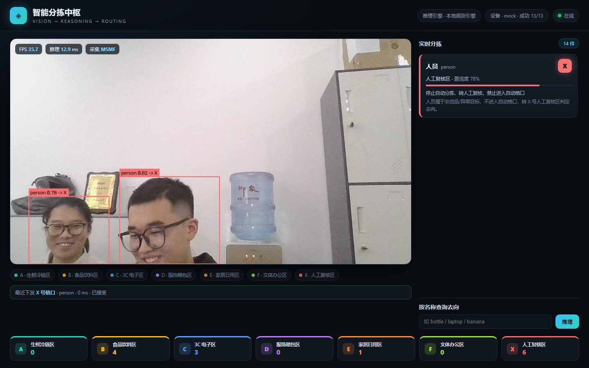

# 智能分拣中枢 · Warehouse Sort AI

摄像头识别物品 → 推理引擎判断最终去向 → Web 前端实时呈现。



## 它做什么

1. **看**：YOLO11 在 30 FPS 的摄像头流里识别物体（COCO 80 类）
2. **想**：推理引擎判断这个物品该去哪个格口、哪个区域、怎么搬运，并给出理由
3. **动**：浏览器里实时显示画面、目标框、去向卡片、各格口计数

## 设备对接（PLC / 机械臂）

判断出格口后，程序会通过 `devices.py` 把指令下发给设备，支持四种后端：

| `DEVICE` | 用途 |
|---|---|
| `mock` | 只记录，用于前端联调（默认） |
| `modbus` | 写 PLC 保持寄存器，等待状态确认 |
| `tcp` | TCP + JSON 行协议，对接网关/机械臂 |
| `mqtt` | 发布到 SCADA / 云端 |
| `off` | 关闭下发 |

没有硬件也能联调：

```powershell
python mock_device.py --mode modbus     # 终端 1：模拟 PLC
$env:DEVICE="modbus"; python app.py     # 终端 2：程序连模拟器
```

完整的接线、握手协议、寄存器表、安全边界和上线步骤见 **[INTEGRATION.md](INTEGRATION.md)**。

## 快速开始

双击 `run.bat`，浏览器会自动打开 <http://127.0.0.1:8765>。
或者：

```powershell
python app.py
```

> 首次运行需要 `flask` 等依赖；从 GitHub 克隆时 `yolo11s.pt` 不在仓库里，
> 首次启动会自动下载（约 18 MB），之后离线可用。

## 架构

```
浏览器 (img /video_feed + 轮询 /api/state)
   │
   ▼
Flask (app.py)
   ├── Camera 线程    MSMF 采集 1280×720 @30fps，只留最新帧
   ├── Pipeline 线程  YOLO11s FP16 推理 → 画框 → 编码 JPEG
   └── Router        规则库 / 可选大模型 → 格口 + 理由
```

三个线程解耦：采集不阻塞推理，推理不阻塞网页，网页永远拿到最新画面。

## 分拣格口

| 格口 | 区域 | 典型物品 | 操作要求 |
|---|---|---|---|
| A | 生鲜冷链区 | 香蕉、苹果、披萨、蛋糕 | 2–8℃ 冷链，30 分钟内入冷库 |
| B | 食品饮料区 | 瓶子、杯子、碗、微波炉 | 常温避光，液体直立 |
| C | 3C 电子区 | 手机、笔记本、键盘、电视 | 防静电、防摔，禁与液体同框 |
| D | 服饰箱包区 | 背包、行李箱、领带、雨伞 | 防潮防压，挂装或平铺 |
| E | 家居日用区 | 椅子、沙发、床、盆栽 | 大件叉车，易碎加护角 |
| F | 文体办公区 | 书、球、滑板、剪刀 | 轻拿轻放，尖锐物单独包裹 |
| X | 人工复核区 | 人、动物、车辆、未知品类 | 停止自动分拣，转人工 |

## 推理引擎

默认是**本地规则引擎**：内置品类知识库 + 格口映射，毫秒级响应、完全离线。

想要更灵活的判断（比如描述性理由、新品类），设置 API Key 即可自动切换到大模型
（OpenAI 兼容接口，默认 DeepSeek）：

```powershell
$env:DEEPSEEK_API_KEY = "sk-..."          # 或者 OPENAI_API_KEY
$env:OPENAI_BASE_URL = "https://api.deepseek.com/v1"   # 可选
$env:LLM_MODEL = "deepseek-chat"                        # 可选
python app.py
```

调用失败或超时会**自动回退**到规则引擎，前端不会中断。

## API

| 接口 | 说明 |
|---|---|
| `GET /` | 前端页面 |
| `GET /video_feed` | MJPEG 实时画面（含目标框和去向标签） |
| `GET /api/state` | 当前目标、FPS、推理耗时、各格口计数 |
| `GET /api/route?name=bottle` | 单独查询某个物品的去向 |
| `GET /api/snapshot` | 当前帧 JPEG |
| `GET /api/health` | 健康检查 |

## 环境变量

| 变量 | 默认 | 说明 |
|---|---|---|
| `PORT` | 8765 | 网页端口 |
| `CAM_WIDTH` / `CAM_HEIGHT` | 1280 / 720 | 采集分辨率 |
| `DEEPSEEK_API_KEY` | 空 | 配置后启用大模型推理 |

## 说明

- 通用模型只认识 COCO 80 类。真实仓库的 SKU 需要采集数据微调（`yolo train`），
  推理和前端这一层不用改，换 `yolo11s.pt` 即可。
- 页面上的中文标签只出现在网页卡片里；视频画面上的框线标签是英文（OpenCV 不支持中文）。
- 摄像头被占用时页面会显示 `CAMERA OFFLINE`，服务不会崩，关掉占用的程序即可恢复。
